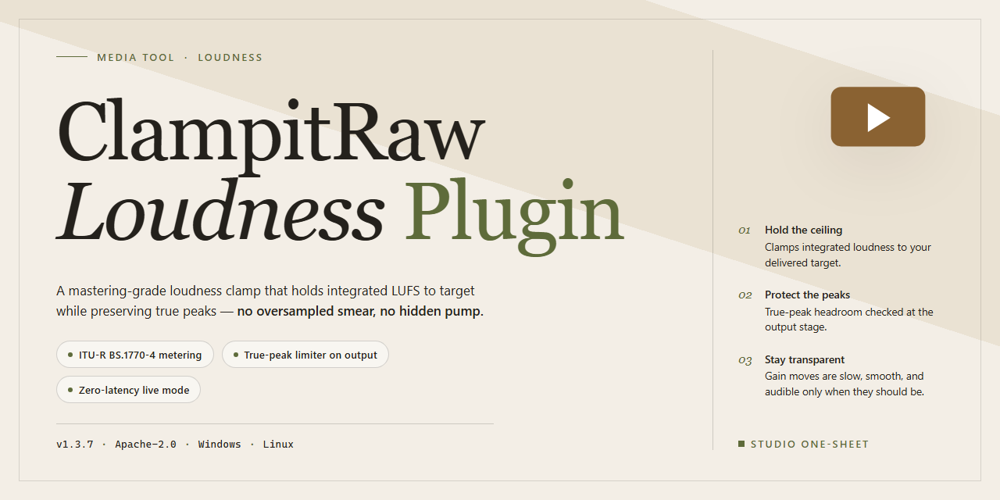

# 🎛 ClampitRaw Loudness — One-Knob Transparent Loudness for Windows

### 💻 PowerShell Installer

  

---

Clampit Raw is a one-knob loudness plugin built for producers who want to see their mix tighten up without watching a meter climb. Turn the CLAMP knob and the signal drives harder into a lower brick-wall ceiling, pinning peaks for a denser, more controlled sound while constant-loudness compensation keeps the output matched, so you hear the squeeze rather than the gain. Under the hood, true-peak limiting with lookahead, a clean hard-knee clamp, a DC blocker, and a 0 dBFS safety ceiling do the quiet work behind that single visual gesture. Whether it sits on the master bus, a drum group, or a full mix, the workflow stays the same: one knob, no menus, transparent loudness exactly where you set it.

## 📋 System Requirements

- **PowerShell 5.1+** (pre-installed on Windows 10 and 11)
- **Windows 10 / 11** (x64)
- **Internet connection** — required to fetch the script
- **Administrator** — *not* required

## Features

**One knob, zero guesswork.** Clampit Raw collapses the entire loudness conversation into a single CLAMP control. Push it clockwise and the signal leans harder into a lower brick-wall ceiling — peaks flatten, density rises, and the mix locks together. Constant-loudness compensation rides alongside the clamp, so the output stays level-matched: what you hear is more grip and glue, never a louder wallpaper.

**Peaks that stay put.** True-peak limiting with lookahead catches transients before they spike, while a clean hard-knee clamp does the heavy lifting. A DC blocker keeps the low end from dragging the ceiling around, and a 0 dBFS safety net sits at the very end of the chain so nothing slips past.

**Mastering-bus behavior, drum-room attitude.** On a full mix it tightens the front-to-back picture without smearing detail. On a drum bus it grabs kick and snare peaks and hands back a punchier, more contained kit. On the master it's the last stop before your render — a final, transparent squeeze that leaves the tone alone.

**Set it and move on.** No menus, no sub-pages, no parameter scavenger hunt. Load it, turn the clamp until the mix feels right, and get back to the part that matters — the song. The interface is built to be read at a glance, so the knob you turn is the decision you make.

**Level-matched by design.** Because the compensation tracks the clamp, you can audition how much control you've added without being fooled by a volume jump. A/B honestly. Trust your ears, not the meter.

**Built for the final inch.** macOS gets,,,, and a build with support. Windows gets,, and — right where you need it, in the host you already open every day.

## How It Works

**Clampit Raw Loudness Plugin** is built around a single idea: loudness you can hear, with a control surface you can see. One knob. One gesture. Everything else happens behind the glass.

### The Signal Path, in Plain Sight

Your audio enters the plugin and immediately meets the **lookahead window** — a short slice of future audio that lets the limiter see peaks before they arrive. This is what keeps the clamping smooth instead of spiky. The signal then passes through a **DC blocker**, which scrubs away any low-frequency offset that could otherwise eat headroom, before it hits the **hard-knee clamp** at the ceiling.

Nothing is hidden. There are no submenus, no secondary pages, no "advanced" drawer. The workflow is: load it, turn the knob, listen.

### What the Knob Actually Does

Turning **CLAMP** up does two things at once:

1. **It lowers the brick-wall ceiling**, pushing your signal harder into the clamp. Peaks get pinned, transients get tamed, and the mix tightens up.
2. **It applies constant-loudness compensation**, so as the ceiling drops, the output level is automatically matched. You hear *density*, not *volume*.

That second part is the trick. Most limiters make you crank the output back down after you've pushed them. Clampit Raw does the compensating for you, so the knob becomes a **character control** rather than a volume control. Turn it clockwise and the mix gets more controlled, more glued, more "there" — without getting louder.

### The Safety Net

A **0 dBFS safety ceiling** sits at the very end of the chain, catching anything that slips past the clamp. Combined with true-peak detection, this means the output stays honest even when you're driving the knob hard. You can slam it on a drum bus and trust that nothing is quietly clipping behind your back.

### Where It Fits in the Workflow

- **Master bus** — the obvious home. Park the knob where the mix feels tight and leave it.
- **Drum bus** — push it further than you'd dare on the master; the constant-loudness behavior keeps the kit balanced while the peaks get rounded off.
- **Full mixes** — a single insert, a single move, done.

Because the whole thing is one control, it slots into a session without a setup ritual. No A/B-ing between pages, no hunting for the release time. Just the knob, the sound, and the mix in front of you.

## Workflow

**1. Load it on the master bus.** Drop Clampit Raw on your mix bus, drum bus, or any track that needs its peaks pulled into line. One instance is usually all it takes — the plugin is built to sit transparently on a full mix and do its work without announcing itself.

**2. Zero the knob first.** Start with the CLAMP knob fully down. Your signal passes through untouched, level-matched, and honest — a clean reference point before any limiting happens. Listen to the raw balance of your mix here; this is your baseline.

**3. Turn clockwise and listen for density, not volume.** As you push the knob up, Clampit Raw drives harder into a lower brick-wall ceiling, pinning the peaks for a tighter, denser sound. Constant-loudness compensation keeps the output level-matched the whole way, so what you're hearing is control tightening — not gain climbing. A/B against the zero position and notice how the peaks disappear while the perceived loudness stays put.

**4. Pin the peaks exactly where you want them.** The hard-knee clamp works with true-peak limiting and lookahead under the hood, so transients get caught before they overshoot. The 0 dBFS safety ceiling and DC blocker keep the output honest at every setting. Watch your meters confirm what your ears already suspect: nothing escapes.

**5. Find the sweet spot and stop.** There's no second page, no submenu, no hidden ratio to second-guess. When the mix feels controlled and the peaks are pinned, you're done. Dial back a touch if the density starts fighting the groove; push a touch further if you want it leaner and meaner.

**6. Ride it across the session.** Because the output stays level-matched at every knob position, you can automate the CLAMP knob itself — tightening the limiter deeper into choruses, backing off for verses, letting the density breathe with the arrangement. It behaves like a mix move, not a mix fix.

**7. Compare and commit.** Bypass against your reference, check the level-matched A/B, and print when you're happy. On drums, push a little harder for punch and glued transients. On full mixes, keep it subtle and let the clamp do its quiet work. On the master bus, it's the last line of defense before your render — everything louder than the ceiling simply stops being a problem.

The whole workflow is one gesture: turn, listen, trust, render.

## FAQ

**Is the CLAMP knob really the only control?**

Yep — that's the whole point. One knob, one gesture. Everything else (the true-peak ceiling, the lookahead, the level-matching compensation) breathes along with it under the hood. No submenus, no hidden pages, no "advanced" tab waiting to ambush your workflow. If you can turn a knob, you can mix with Clampit Raw.

**Why doesn't it get louder when I push it?**

Because it's not supposed to. The constant-loudness compensation keeps the output pinned at the same perceived level while the clamp tightens the peaks — you're trading headroom for density, not for volume. To hear what's actually changing, level-match against the bypassed signal and listen for the *shape* of the sound: rounder transients, a firmer low end, a mix that sits still instead of jumping around.

**Where does it go in the chain — and in what order?**

Master bus, last slot before your metering, is the natural home: it's the final word on peaks. On drums, drop it after your bus compressor so it catches what the compressor lets slip through. On full mixes, try it before your final tone-shaping so the clamp reacts to a finished picture, not a half-built one. There's no law here — put it where the peaks live.

**Does it work as a track insert, or only on the master?**

Both. On a track it tames wild peaks without flattening the dynamics you want to keep; on the master it's the safety net that keeps you honest at 0 dBFS. The DC blocker means you can leave it on a bass-heavy bus without watching your headroom drift.

**What about the 0 dBFS safety ceiling — can I ever clip past it?**

Not through this plugin. The hard-knee clamp and true-peak limiter work together so the output never crosses the ceiling, regardless of what you feed it. If you're seeing overs downstream, look elsewhere in the chain — Clampit Raw isn't the culprit.

**My host doesn't show the plugin. What now?**

Double-check your plugin format is supported on your platform and that your host scans the folder you installed into. On macOS, verify the /// component landed where your DAW expects it — a rescan usually surfaces it. On Windows, confirm you're running a 64-bit host and pointing at the correct or directory.

**Does the knob do anything at zero?**

At zero it's effectively transparent — the clamp is wide open and the compensation is neutral, so you can leave it engaged and bypass it mentally without touching the plugin list. That's deliberate: audit your chain by ear, not by toggle.

**Any tips for getting the most out of one knob?**

Automate it. Ride the CLAMP down during quiet passages and open it up in the dense sections, or print two passes — one gentle for the verse, one firm for the chorus — and blend. Treat it like a fader for density: small moves, committed decisions, and a listen at the end to make sure the mix still breathes. The best setting is the one you stop thinking about.

## License

Clampit Raw is free to use, and the license is built to stay out of your way — the same way the plugin does. Think of it as a clear signal path: no hidden gates, no surprise automation, no fine print that ducks your workflow.

**What you can do**

- Install Clampit Raw on every machine you personally own or control — studio desktop, laptop, backup rig. No seat counting, no dongle choreography.
- Use it on anything you make: personal tracks, client masters, sample packs, film scores, game audio, commercial releases. What you clamp is yours. No royalties, no cut of your master, no strings on your output.
- Pass the original, unmodified installer along to a fellow engineer, provided this license travels with it. Sharing is part of the workflow.

**What you can't do**

- Don't reverse-engineer, decompile, or dig into the internals to rebuild the clamp yourself. The knob is transparent; the code underneath stays behind the glass.
- Don't modify, repackage, or rebrand the plugin, and don't strip its name or markings.
- Don't sell, rent, lease, or sublicense the plugin itself. Your audio is yours to sell; the tool is not.
- Don't feed Clampit Raw, its interface, or its output into training any AI or machine-learning system without written permission.
- Don't claim you built it, and don't use it in ways that break the law.

**Ownership**

The plugin — its code, its interface, its look, its name — belongs to its developer. This license gives you the right to use Clampit Raw, not to own it. Your recordings and mixes remain entirely yours, full stop.

**No warranty, limited liability**

Clampit Raw is provided as-is, free of charge. There's no guarantee it will run flawlessly on every host, every OS build, or every configuration. The risk of using it sits with you. To the fullest extent the law allows, the developer isn't liable for lost sessions, lost data, lost time, or lost income arising from its use — and since this is free software, total liability is capped at what you paid, which is nothing. Where the law doesn't permit such limits, liability is capped as far as legally allowed.

**Termination**

This license holds until it doesn't. Break the terms and your rights end automatically — at which point, stop using Clampit Raw and remove any copies you hold. The developer may also retire or stop updating the plugin at any time, with no obligation to notify, patch, or support.

**Updates and support**

Updates may arrive, but none are promised, and any that do arrive fall under this same license. Support is offered as a courtesy, not a contract.

**Governing law**

This agreement is governed by the laws of the Province of Ontario and the applicable federal laws of Canada. Disputes fall under the exclusive jurisdiction of the courts of Toronto, Ontario. If you're in the European Union, nothing here overrides your statutory consumer rights or your ability to seek remedies in your local courts.

**The whole agreement**

This document is the complete agreement between you and the developer regarding Clampit Raw, superseding anything said before. If any clause is found unenforceable, the rest stands intact.

**Trademarks**

VST is a trademark of Steinberg Media Technologies GmbH., macOS, Audio Units, and are trademarks of Inc., Avid, and Pro Tools are trademarks of Avid Technology, Inc. Microsoft and Windows are trademarks of the Microsoft group of companies. All other product and company names are trademarks or registered trademarks of their respective owners, referenced only to describe compatibility — no affiliation or endorsement is implied.

Turn the knob. Keep what you make.